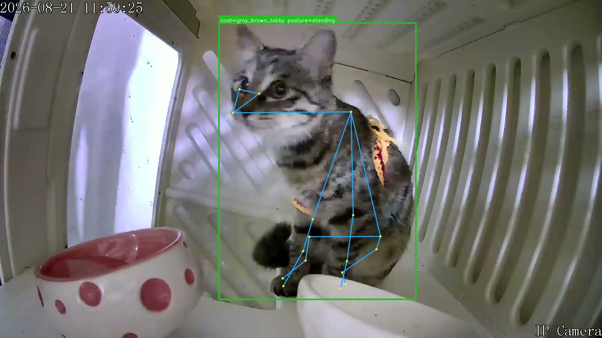
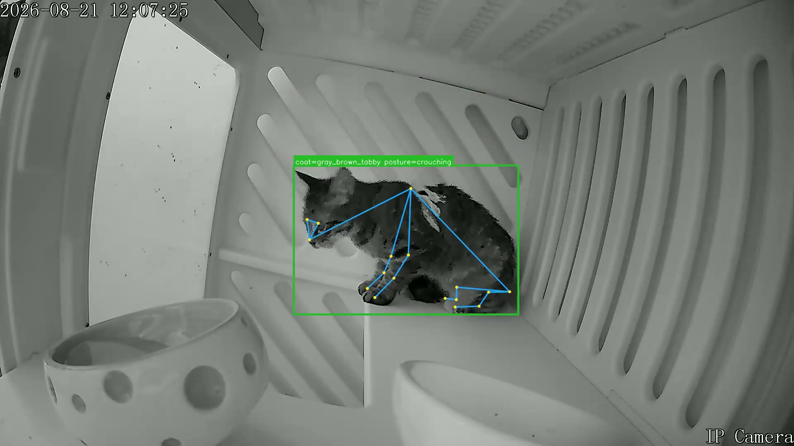

# 猫咪行为识别演示

无需安装模型即可查看本目录的标注结果：

- [30 秒标注视频](cat-behavior-demo.mp4)：720p / 15 FPS / H.264，直接下载并用浏览器或播放器播放。
- [彩色画面与 standing 标签](cat-standing.jpg)：猫检测框、毛色标签与姿态骨架。
- [红外画面与 crouching 标签](cat-crouching.jpg)：夜间画面中的同类叠加输出。

这些素材从 2026-08-21 既有标注录像中选取。视频截取其中 30 秒并降低分辨率和帧率，
移除音轨和容器元数据；截图保留原有标注。素材展示历史模型的输出形式，标签可能出现
误判，不代表当前版本的准确率评测或端到端后端验收结果。

原始视频、其余录像和训练图片保留在服务器数据目录。仅本目录明确列出的三个媒体文件
随源码分发；`.gitignore` 对其他图片和视频默认忽略。
