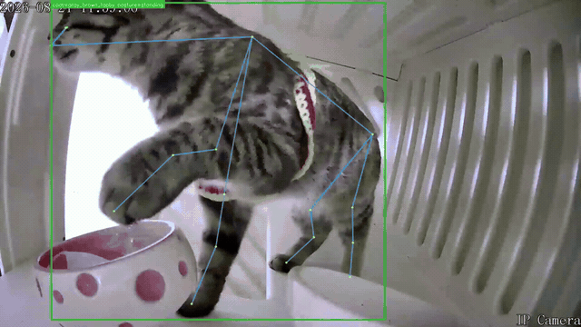

# 行为识别 · 展示与复现

[30秒原演示视频](../demo/cat-behavior-demo.mp4) · [彩色截图](../demo/cat-standing.jpg) · [红外截图](../demo/cat-crouching.jpg)

`behavior-preview.gif` 由仓库原有 `docs/demo/cat-behavior-demo.mp4` 的第 1–6 秒转换而来：宽 640 像素、6 FPS、循环播放。没有加入新的原始监控录像、身份映射或生产事件。来源与历史模型边界沿用 [原演示说明](../demo/README.md)。

本地复现需先按 [项目 README](../../README.md) 的快速开始准备 Python 依赖，使用 `configs/models.github.yaml` 读取已发布权重，并对自行准备的视频执行对应推理命令。运行时同时观察叠加画面与 JSONL / CSV 输出；实时 Viewer 的准备方法见 [Viewer 说明](../../web/stream-viewer/README.md)。

`workflow.svg` 只概括当前已实现的推理链路，不表示图库 Re-ID、余粮模型或自动评估报告已经完成。
